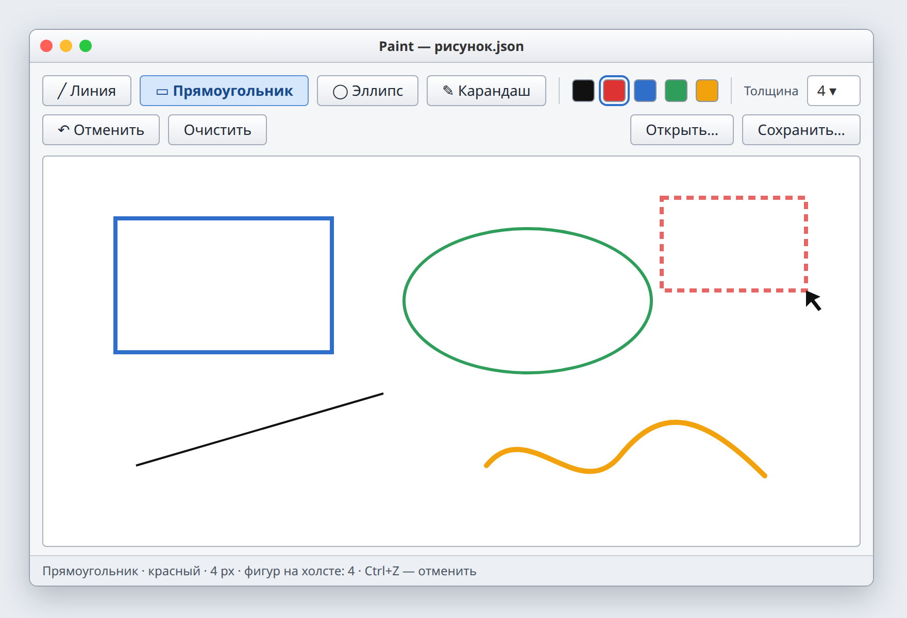

# Лаба 2. Графический редактор

| | |
| --- | --- |
| Состав | 1 человек |
| Выдача | 31.10.2026 |
| Срок PR | 13.11.2026, 23:59 |
| Сдача | 14.11.2026 |
| Ветка, папка | `lab2`, `lab2-paint/` |
| Баллы | 14: чек-лист 6, вопрос 2, ★ 3, ★★ 3 |



*Примерный вид. Оформление на ваш выбор.*

## Темы

Наследование, вызов конструктора базового класса, переопределение методов, полиморфизм, абстрактный класс, композиция, события мыши, восстановление объектов разных классов из файла, паттерны Фабрика и Команда.

## Теория

**Наследование.** Наследник получает поля и методы базового класса и добавляет свои. Наследование описывает отношение «является»: прямоугольник является фигурой. Общее (точки, цвет, толщина) пишется один раз в базовом классе.

```csharp
public abstract class Shape
{
    public Point Start { get; protected set; }
    public Point End { get; protected set; }
    public Color Color { get; }
    public int Width { get; }

    protected Shape(Point start, Color color, int width)
    {
        Start = End = start;
        Color = color;
        Width = width;
    }

    public virtual void MoveEnd(Point p) => End = p;

    // Прямоугольник по двум точкам: тянуть можно в любую сторону
    protected Rectangle Bounds() => new(
        Math.Min(Start.X, End.X), Math.Min(Start.Y, End.Y),
        Math.Abs(End.X - Start.X), Math.Abs(End.Y - Start.Y));

    public abstract void Draw(Graphics g);
}

public class RectShape : Shape
{
    public RectShape(Point start, Color color, int width) : base(start, color, width) { }

    public override void Draw(Graphics g)
    {
        using var pen = new Pen(Color, Width);
        g.DrawRectangle(pen, Bounds());
    }
}
```

**Переопределение и полиморфизм.** У каждой фигуры свой `Draw`. Код, который рисует рисунок, не знает, какие фигуры в списке:

```csharp
foreach (var shape in _shapes)
    shape.Draw(g);
```

Вызовется `Draw` того класса, которым объект является на самом деле. Новая фигура = новый класс, цикл не меняется. Проверки вида `if (shape is RectShape)` для рисования не нужны.

**Абстрактный класс.** «Просто фигуру» нарисовать нельзя, поэтому `Shape` абстрактный: объект создать нельзя, а `Draw` объявлен без реализации. Каждый наследник обязан его реализовать.

**Композиция.** Рисунок содержит список фигур: это поле класса `Drawing`, а не наследование. Рисунок умеет добавить фигуру, отменить последнюю, очистить, сохранить.

**Мышь.** Нажатие: создать фигуру. Перемещение с нажатой кнопкой: сдвинуть вторую точку и перерисовать (предпросмотр). Отпускание: фигура готова. Холст каждый раз перерисовывается по списку фигур.

**Тянуть в любую сторону.** Угол прямоугольника берётся как минимум координат, размер как модуль разницы.

**Карандаш.** `PencilShape` хранит список точек. Пока мышь тянут, он не двигает вторую точку, а добавляет новую: для этого `MoveEnd` в `Shape` объявлен `virtual`, а карандаш его переопределяет. `Draw` рисует ломаную по точкам. В файл сохраняется весь список точек.

```csharp
public class PencilShape : Shape
{
    private readonly List<Point> _points = new();

    public PencilShape(Point start, Color color, int width) : base(start, color, width)
    {
        _points.Add(start);
    }

    public override void MoveEnd(Point p)
    {
        base.MoveEnd(p);
        _points.Add(p);
    }

    public override void Draw(Graphics g)
    {
        if (_points.Count < 2) return;
        using var pen = new Pen(Color, Width);
        g.DrawLines(pen, _points.ToArray());
    }
}
```

**Фабрика.** Окно знает только имя инструмента (`"RectShape"`), а в файле у каждой фигуры записан тип. Из строки надо получить объект нужного класса. Без фабрики одинаковый `switch` по строке появится дважды: в окне и в загрузке, и при новой фигуре его легко поправить только в одном месте. Паттерн Фабрика собирает создание в одном месте: словарь «имя типа → как создать». По нему окно делает кнопки инструментов, нажатие мыши создаёт фигуру, загрузка восстанавливает фигуры из файла.

```csharp
public static class ShapeFactory
{
    public static readonly Dictionary<string, Func<Point, Color, int, Shape>> Kinds = new()
    {
        ["LineShape"] = (p, c, w) => new LineShape(p, c, w),
        ["RectShape"] = (p, c, w) => new RectShape(p, c, w),
        ["EllipseShape"] = (p, c, w) => new EllipseShape(p, c, w),
        ["PencilShape"] = (p, c, w) => new PencilShape(p, c, w),
    };

    public static Shape Create(string kind, Point start, Color color, int width) =>
        Kinds[kind](start, color, width);
}
```

Новая фигура = новый класс и одна строка в словаре. Окно и загрузка не меняются.

**Команда (для ★★).** Ctrl+Z из чек-листа просто убирает последнюю фигуру. Но как отменить удаление или очистку и вернуть отменённое по Ctrl+Y? Паттерн Команда: каждое действие это объект, который умеет себя выполнить и отменить. История хранит команды в двух стеках: что можно отменить и что можно повторить. Для этого у `Drawing` нужен ещё метод `Remove(shape)`.

```csharp
public interface ICommand
{
    void Execute();
    void Undo();
}

public class AddShapeCommand : ICommand
{
    private readonly Drawing _drawing;
    private readonly Shape _shape;

    public AddShapeCommand(Drawing drawing, Shape shape)
    {
        _drawing = drawing;
        _shape = shape;
    }

    public void Execute() => _drawing.Add(_shape);
    public void Undo() => _drawing.Remove(_shape);
}

public class History
{
    private readonly Stack<ICommand> _undo = new();   // что можно отменить
    private readonly Stack<ICommand> _redo = new();   // что можно повторить

    public void Do(ICommand command)
    {
        command.Execute();
        _undo.Push(command);
        _redo.Clear();          // новое действие: повторять больше нечего
    }

    // Undo: взять команду из _undo, вызвать у неё Undo(), положить в _redo.
    // Redo: наоборот. Удаление и очистка это ещё две команды.
}
```

Окно больше не вызывает `_drawing.Add(shape)` напрямую, а делает `_history.Do(new AddShapeCommand(_drawing, shape))`.

Все паттерны курса с примерами: [patterns.md](patterns.md).

## Задание

Редактор, в котором мышью рисуются линии, прямоугольники, эллипсы и кривые карандашом. Пользователь может:

1. выбрать инструмент, цвет и толщину;
2. нарисовать фигуру протягиванием мыши, видя её во время протягивания;
3. отменить последнюю фигуру (Ctrl+Z) и очистить холст;
4. сохранить рисунок в файл и открыть его.

| Класс | Отвечает за |
| --- | --- |
| `Shape` (абстрактный) | общее для фигур: точки, цвет, толщина, `Draw` |
| `LineShape`, `RectShape`, `EllipseShape` | свой `Draw` |
| `PencilShape` | хранит список точек |
| `Drawing` | список фигур: добавить, отменить, очистить, нарисовать, сохранить, загрузить |
| `MainForm` | окно, инструменты, мышь |

## Чек-лист

1. **Окно.** Холст, выбор инструмента, цвета и толщины. Выбранный инструмент виден.
2. **Фигуры.** Линия, прямоугольник, эллипс рисуются протягиванием с предпросмотром в любом направлении. Карандаш рисует кривую.
3. **Иерархия.** Абстрактный `Shape`, у каждой фигуры свой `Draw`. Рисунок рисуется одним циклом без проверки типа фигуры.
4. **Отмена и очистка.** Ctrl+Z убирает последнюю фигуру, «Очистить» убирает все. Это методы `Drawing`.
5. **Файл.** Сохранение в JSON и открытие с восстановлением всех фигур, цветов и толщин. Объект нужного класса по типу из файла создаёт фабрика: одно место на всю программу.
6. **README.** Как запустить, скриншот, чек-лист, как устроен проект.

## Доп. задания

**★ (3 балла).** Выделение фигуры щелчком, перемещение мышью, удаление клавишей Delete. Чтобы найти фигуру под курсором, у `Shape` есть абстрактный метод `Contains(point)`, и каждая фигура реализует его сама: прямоугольник проверяет, что точка внутри, линия проверяет, что точка рядом с отрезком.

**★★ (3 балла).** Отмена и повтор (Ctrl+Z, Ctrl+Y) через паттерн Команда: каждое действие (нарисовать, удалить, очистить) это объект с методами `Execute()` и `Undo()`, история хранит команды. Экспорт рисунка в PNG.

## Вопросы

1. Что такое наследование?
2. Зачем вызывать конструктор базового класса?
3. Что значит «абстрактный класс»?
4. Что такое полиморфизм? Где он у вас?
5. Что нужно добавить, чтобы появился треугольник?
6. Что такое переопределение метода?
7. Почему список фигур хранит тип `Shape`, а не конкретные классы?
8. Что такое паттерн Фабрика? Где он у вас?
