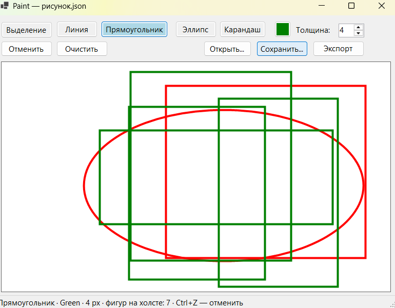

# Лабораторная работа №2: Графический редактор Paint

Приложение для рисования на C# (Windows Forms, .NET 8.0). 
Демонстрирует принципы ООП (наследование, полиморфизм) и паттерны проектирования (Фабрика, Команда).

## 📸 Скриншот
*(Сделай скриншот своего окна, сохрани его как `screenshot.png` в папку с проектом и раскомментируй строку ниже)*
  

## 🚀 Как запустить
1. Установи **Visual Studio 2022** (с компонентом «Разработка классических приложений .NET»).
2. Открой файл решения **`lab2.sln`**.
3. Нажми **F5** (или зелёную кнопку «Пуск»), чтобы собрать и запустить проект.

## ✅ Чек-лист выполненных требований

### Основное задание
- [x] **Окно и инструменты:** Холст, выбор инструмента (Линия, Прямоугольник, Эллипс, Карандаш), выбор цвета и толщины.
- [x] **Рисование с предпросмотром:** Фигуры рисуются протягиванием мыши в любом направлении, видны во время рисования.
- [x] **Иерархия классов:** Абстрактный `Shape`. Наследники переопределяют `Draw()`. Отрисовка холста идет одним циклом (полиморфизм).
- [x] **Отмена и очистка:** Кнопка «Очистить» и отмена последнего действия по `Ctrl+Z`.
- [x] **Файл (JSON):** Сохранение и загрузка. Восстановление фигур происходит через `ShapeFactory` (паттерн Фабрика). Координаты, цвета и толщины сохраняются корректно.

### Дополнительные задания
- [x] **★ Выделение и перемещение:** Инструмент «Выделение». Клик по фигуре выделяет её (рамка). Можно перетаскивать мышью. Удаление выделенной фигуры — клавиша `Delete`. Для поиска фигуры реализован метод `Contains(Point)`.
- [x] **★★ Паттерн Команда (Undo/Redo):** Все действия (добавление, удаление, очистка, перемещение) — это команды (`ICommand`). История (`History`) хранит стеки. `Ctrl+Z` — отменить, `Ctrl+Y` — повторить.
- [x] **★★ Экспорт в PNG:** Кнопка «Экспорт PNG» сохраняет холст в картинку.

## 📂 Как устроен проект

Код разделен на логические файлы для удобства чтения:

* **`Program.cs`** — точка входа в приложение.
* **`MainForm.cs`** — логика окна: обработка кликов мыши, горячих клавиш, работа с историей.
* **`MainForm.Designer.cs`** — визуальное оформление окна (кнопки, панели).
* **`Shapes.cs`** — иерархия фигур (базовый `Shape` и его наследники) и **`ShapeFactory`** (паттерн Фабрика).
* **`Drawing.cs`** — класс «Рисунок» (список фигур, сохранение/загрузка JSON) и реализация **паттерна Команда** (`ICommand`, `History` и классы команд).